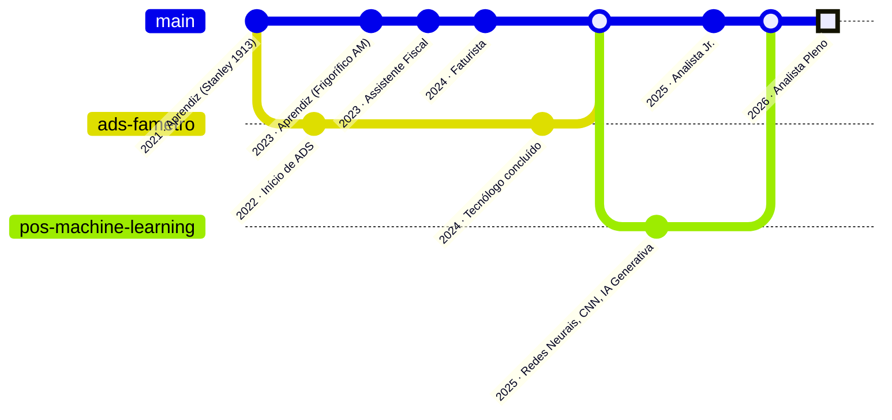

<!-- ===================== HEADER ===================== -->
<p align="center">
  
</p>

<p align="center">
  <a href="https://andre-jnr.github.io/andre-jnr/">
    
  </a>
</p>

<p align="center">
  <a href="https://www.linkedin.com/in/andre-jnr/"></a>
  <a href="https://andre-jnr.github.io/andre-jnr/"></a>
  <a href="mailto:andrejr.comercial@gmail.com"></a>
  <a href="https://andre-jnr.github.io/andre-jnr/assets/ANDRE%20JUNIOR%20-%20CURRICULO.pdf"></a>
</p>

---

## 🧑‍💻 `whoami`

```python
class AndreJunior:
    """Contrataria um analista que programa? Ou um dev que entende de nota fiscal?
    Por que não os dois."""

    local     = "Manaus, AM 🌳"
    cargo     = "Analista de Faturamento Pleno @ Frigorífico Amazonas"
    formacao  = ["Tecnólogo em ADS — Fametro",
                 "Pós em Machine Learning — Fametro (bolsa por alto desempenho)"]
    dia_a_dia = ["SQL Server", "Power BI", "Python", "DRE integrado", "liderança de equipe"]
    obsessao  = "automatizar tudo o que alguém faz duas vezes"

    def missao(self) -> str:
        return "Transformar notas fiscais em dados, e dados em decisões."

    def fun_fact(self) -> str:
        return "Já fiz um site todo rosa só porque era para a minha irmã. 💖"
```

## 📈 Impacto em números

<div align="center">

| ⏱️ Entrada de nota | 📉 Tempo operacional | 🚀 Promoções internas | 🗂️ Repositórios públicos |
|:---:|:---:|:---:|:---:|
| **15 min → 2 min** | **−87%** | **4** em ~3 anos | **45+** |

</div>

## 🌱 `git log --career`

> Cada promoção foi um *commit* e cada formação um *branch* que voltou para a `main`.



## 🛠️ Stack

<p align="center">
  <a href="https://skillicons.dev">
    
  </a>
</p>

<p align="center">
  
  
  
  
  
  
  
  
</p>

## 🚀 Projetos que resolvem problemas reais

<table>
  <tr>
    <td width="50%" valign="top">
      <h3>🧮 <a href="https://github.com/andre-jnr/calculo-custo-unitario">Cálculo de Custo Unitário</a></h3>
      Importa o XML da nota e calcula sozinho SUFRAMA, ICMS e frete até chegar ao custo final do produto.<br/>
      <b>Resultado:</b> de 15 para 2 minutos por nota.<br/><br/>
      <a href="https://calculo-custo-unitario.streamlit.app/"></a>
    </td>
    <td width="50%" valign="top">
      <h3>🎮 <a href="https://github.com/andre-jnr/lanca-certo">Lança Certo</a></h3>
      Um <i>quiz</i> que treina a equipe na entrada de nota fiscal, com regras tiradas do guia de faturamento. Treinamento que ninguém pula.<br/><br/>
      <a href="https://andre-jnr.github.io/lanca-certo/"></a>
    </td>
  </tr>
  <tr>
    <td width="50%" valign="top">
      <h3>🤖 <a href="https://github.com/andre-jnr/leitor-nfe-ambev">Leitor NF-e Ambev</a></h3>
      Automação em Python que lê as notas eletrônicas do fornecedor e faz a entrada sem digitação manual.
    </td>
    <td width="50%" valign="top">
      <h3>🎯 <a href="https://github.com/andre-jnr/metas-frigoam">Metas FrigoAM</a></h3>
      Painel de metas em <b>tempo real</b> para a equipe. Antes era manual: baixar os dados do sistema e alimentar uma planilha nada visual.<br/>
      <b>Resultado:</b> meta mais fácil de entender e colaboradores correndo atrás dela todo dia.
    </td>
  </tr>
  <tr>
    <td width="50%" valign="top">
      <h3>🧭 <a href="https://github.com/andre-jnr/atlas">Atlas</a></h3>
      Um painel local para catalogar projetos, acompanhar pendências e guardar o histórico de tudo, com data e hora.
    </td>
    <td width="50%" valign="top">
      <h3>🧠 <a href="https://github.com/andre-jnr/DSA-AI-Coder">DSA AI Coder</a></h3>
      Agente de IA em Python que funciona como assistente de programação.
    </td>
  </tr>
</table>

<details>
<summary><b>🗂️ Ver mais ferramentas do setor fiscal e de faturamento</b></summary>
<br/>

| Projeto | O que faz |
|---|---|
| [manual-faturamento](https://github.com/andre-jnr/manual-faturamento) | Guia prático de entradas, saídas e situações fiscais |
| [fechamento-fiscal](https://andre-jnr.github.io/fechamento-fiscal/) | Planilha de fechamento sempre atualizada, a um clique |
| [protocolo-financeiro](https://github.com/andre-jnr/protocolo-financeiro) | Gera protocolos financeiros a partir dos lançamentos de NF |
| [relatorio-de-margens-aplicadas](https://github.com/andre-jnr/relatorio-de-margens-aplicadas) | Controle de margens aplicadas por produto |
| [relatorio-de-nfe-lancadas](https://github.com/andre-jnr/relatorio-de-nfe-lancadas) | Notas fiscais lançadas por dia |
| [entrada-nestle](https://andre-jnr.github.io/entrada-nestle/) | Novo custo já com ICMS ST |
| [entrada-gouveia](https://github.com/andre-jnr/entrada-gouveia) | Calculadora de preço de custo |
| [painel-fiscal](https://github.com/andre-jnr/painel-fiscal) | Portal com os repositórios úteis do setor |
| [excel-em-sql](https://github.com/andre-jnr/excel-em-sql) | Converte planilhas do Excel em tabelas SQL |
| [Cálculo dos Fatores de Redução](https://andre-jnr.github.io/Calculo-dos-Fatores-de-Reducao-de-Limites/) | 💖 O site rosa da minha irmã (Segurança do Trabalho) |

</details>

## 📊 Estatísticas

<p align="center">
  
  
</p>

<p align="center">
  
</p>

<p align="center">
  <picture>
    <source media="(prefers-color-scheme: dark)" srcset="https://raw.githubusercontent.com/andre-jnr/andre-jnr/output/github-snake-dark.svg"/>
    <source media="(prefers-color-scheme: light)" srcset="https://raw.githubusercontent.com/andre-jnr/andre-jnr/output/github-snake.svg"/>
    
  </picture>
</p>

## 📫 Bora conversar?

<p align="center">
  Aberto a projetos e colaborações em <b>dados</b>, <b>BI</b>, <b>automação fiscal</b> e <b>IA</b>.<br/>
  Se você tem um processo que alguém repete todo dia, eu provavelmente quero automatizar. 😉
</p>

<p align="center">
  <a href="https://www.linkedin.com/in/andre-jnr/"></a>
</p>


